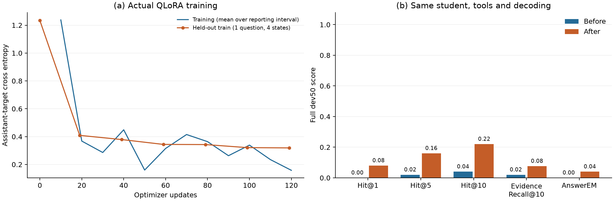

# 附加题 2 实验结果

在相同 Qwen2.5-1.5B 基座、BM25 工具、提示词、greedy 解码和预算下，完整 dev50 的 GoldHit@10 从 **0.04 提升到 0.22**，新增命中 9 题，原有 2 题均保留；AnswerEM 从 0 提升到 0.04。平均单题耗时由 7.91 秒增加到 20.32 秒，输出 token 接近原来的 5 倍。后训练提高了本次文档命中率，仍存在明显的重复生成、终止失败和证据理解问题。

这组因果对照是同一 1.5B 工具 Agent 的无适配器/有适配器比较。仓库原有 BM25 与 BGE-M3 混合检索 dev Hit@10=0.44 属于另一套检索流程，见 [基础结果](RESULTS.md)，不能把不同流程的差异归因于 LoRA。

## 数据与实际训练

仅从课程 train100 采集本地 Qwen3-4B-Instruct-2507 教师轨迹。教师完整 train100 通过官方检查，Hit@10=0.23、AnswerEM=0.05、`ok` 占比 0.88；这是训练集表现，不与学生 dev50 直接横比。[教师记录](../records/posttraining/teacher_train.json)

按原始题目、固定 seed=2026 划分内部验证，再做质量筛选。最终保留 21 道题、78 条唯一逐步样本：训练 20 题/74 条，内部验证 1 题/4 条。唯一目标含 23 次搜索、43 次读取、12 次终止。71 条使用教师原始动作；7 条终止答案使用训练标签校正，前提是标准答案能在该回合模型实际可见的 gold 原文中逐字核验。9 条缺少这种支持的终止目标被剔除，原始教师输出与工具轨迹全部保留。不是将校正答案声称为教师原答。[唯一数据统计](../records/posttraining/data_statistics.json)

最终训练侧将终止目标重复采样 3 次，得到 98 条训练记录；内部验证仍为同一题的 4 条原始记录，未重复采样。唯一题目、数据来源和分组均不变。最大序列为 3,831 tokens，没有截断监督目标；`mask_prompt=true`，只对最后一条 assistant 消息计算损失，历史动作和工具返回只作输入。[采样统计](../records/posttraining/data_statistics_balanced.json)

| 最终训练配置 | 数值 |
| --- | --- |
| 学生 | MLX Qwen2.5-1.5B-Instruct，固定 revision，4-bit 基础权重 |
| LoRA | 后 4 层，rank 8，scale 8，dropout 0.05 |
| 可训练参数 | 1,318,912，约占基座 0.085% |
| 优化器 | AdamW，学习率 2e-5，batch 1 |
| 更新数 / seed | 120 / 2026 |
| 最大序列 / 梯度检查点 | 4096 / 开启 |
| 实际训练墙钟 | 225.344 秒 |
| MLX 设备分配峰值 | 4,426,792,628 bytes |
| 进程 RSS 峰值 | 1,300,480,000 bytes |
| 适配器 | 5,281,601 bytes，56 个有限数值张量，28 个 LoRA-B 均已发生非零更新 |

设备分配峰值与 RSS 在统一内存机器上重叠，不相加。实验环境为 Apple Silicon、32 GB 统一内存、Python 3.12.15；软件版本、代码提交、配置/数据/日志摘要均在 [实际训练记录](../records/posttraining/training_summary.json) 中。固定使用该候选第 120 次更新的适配器；MLX 验证损失在对应编号更新之前计算。[权重核验](../records/posttraining/adapter_verification.json)

初始后 16 层、学习率 1e-4 的 240 步方案确实完成训练，但开发筛查出现重复词和重复文档 ID 退化，于完成 6 道 dev 题后中止，不作为完整 dev50 结果。其 40/80 步检查点在各 3 道 train 题的稳定性检查中也都耗尽预算。保守方案在相同 train3 检查中为 1 `ok`、2 预算失败，随后固定权重完成全部 dev50。初始训练、筛查与诊断记录保留，没有用测试结果选择配置。[初始训练](../records/posttraining/training240_summary.json)、[中止筛查](../records/posttraining/candidate240_screening.json)、[检查点诊断](../records/posttraining/checkpoint_stability_probes.json)

## 完整 dev50 对照

| 指标 | 无适配器 | 最终 LoRA |
| --- | ---: | ---: |
| GoldHit@1 | 0.00 | 0.08 |
| GoldHit@5 | 0.02 | 0.16 |
| GoldHit@10 | 0.04 | 0.22 |
| EvidenceRecall@10 | 0.020000 | 0.076246 |
| AnswerEM | 0.00 | 0.04 |
| `ok` / 50 | 22 | 28 |
| `budget_exceeded` / 50 | 28 | 22 |
| 平均工具调用 | 3.52 | 2.32 |
| 平均模型调用 | 7.58 | 7.46 |
| 无效动作总数 | 180 | 229 |
| 输入 token 总数 | 635,360 | 808,522 |
| 输出 token 总数 | 9,933 | 49,272 |
| 平均每题秒数 | 7.909486 | 20.320760 |
| 官方提交检查错误 | 0 | 0 |

两组均完整覆盖 50 题，失败保留在分母中。模型每题重新加载，加载时间计入单题耗时；模型工具事件与普通模型生成分别统计，重复历史的输入 token 也计入。全部 token 可取得完整统计。本地模型 API 费用为 0，电费未计量。[完整对照记录](../records/posttraining/dev_comparison.json)

工具调用减少并不意味着推理更便宜：模型调用次数近似不变，而无效动作和输出 token 增加。部分失败回合连续生成重复 ID 或未闭合 JSON，消耗模型计算却没有执行有效工具。后训练的 11 个 gold 命中中，7 个为 `ok`、4 个来自保留部分检索结果的预算失败；不能将全部命中视作成功回答。严格答案匹配成功仅 2/50。[行为统计](../records/posttraining/behavior_analysis.json)



## 四个案例的行为复核

公开仓库只给出匿名行为摘要。含完整题目、参考答案、原文引用和逐步动作的四例位于本地课程交付包的 `BONUS2_REPORT.md`，遵循 [数据使用约定](../DATA_USE.md)。

| 案例 | 实际行为与结论 |
| --- | --- |
| A：人物名抽取成功 | 训练前未命中，训练后命中且 AnswerEM=1；5 次工具调用、6 个模型回合、无格式错误。相关原文明确出现最终姓名，但日志不能证明问题的全部复杂条件均已逐项核验。 |
| B：已召回证据却未成功终止 | 初次搜索观测已出现参考人物，之后终止 JSON 反复重复同一文档 ID。12 个模型回合中有 10 次无效动作，仅执行 2 次工具调用；预算失败，保留的排名仍命中 gold。 |
| C：表格与主体混淆 | 命中了年度报告；对应费用行可支持参考答案，但模型选择了另一文档中不同主体、不同指标的百分比。括号表示的下降幅度不能因未逐字匹配标签字符串就被归类为“没有证据”；此处属于表格理解及证据选择错误。 |
| D：范围与动作结构错误 | 检索未命中 gold；模型先给出 end 小于 start 的范围，又输出缺少 action 键的对象，累计 10 次无效动作并耗尽模型回合。是查询/动作恢复失败，不是 600 秒超时。 |

## 复跑、冻结测试与交付

公开适配器复制并精简加载配置后，独立复跑 dev 前 3 题，答案、文档排序、引用和状态 **3/3 完全一致**，token 数也一致；这是有界抽查，不是第二次完整 dev50。[复跑记录](../records/posttraining/replay_check.json)

最终 test50 全量运行并通过 `--submission` 检查：23 `ok`、27 `budget_exceeded`，全部保留结果与轨迹，平均每题 17.665282 秒。测试标签由教师持有，本地不推断测试命中率或答案正确率。模型、参数和适配器摘要在测试前已冻结。[测试提交检查与成本](../records/posttraining/test_final.json)

dev 运行曾按用户要求暂停，已完成的 28 条记录原样保留，剩余 22 条复用课程同一 worker 接续；没有重试已完成的失败题。中断尝试的部分决策另存，续跑前后摘要和保留检查在私有运行目录中。单题耗时不含暂停时间，额外中断计算另存审计，未混入完整尝试的单题耗时。

冻结适配器为 [adapters.safetensors](../weights/posttraining/adapters.safetensors)，SHA256：

```text
d7d1454bc488246cb3b50226a9836d5d61b257aec3980221bc0476aaaf21ada8
```

运行与复现见 [后训练说明](POSTTRAINING.md)。公开 PR 包含代码、配置、合成测试、聚合记录、图件和适配器；完整逐题材料与训练样本放在课程内部交付包中。

## 结论的边界

本实验只有 20 道用于梯度训练的原始题，内部验证仅 1 题/4 个状态且未保留终止目标；低验证损失不能代表复杂新问题上的 Agent 稳定性。最终方案同时改变了训练层数、学习率和终止采样比例，没有单独分离各因素的贡献，也没有多随机种子实验。文档命中和引用原文匹配不等于语义正确，公开模型是否曾见过上游基准也无法完全排除。本次可确认的是所列固定条件下的完整 dev50 改善及相应计算成本增加，测试效果仍由教师统一评测。
